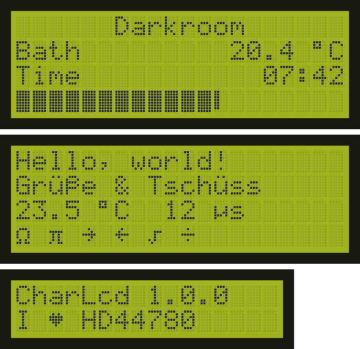

# CharLcd

Driver for HD44780-compatible character LCDs (16x2, 20x4, 16x4, 40x2, 40x4, ...), over the
common **PCF8574 I2C backpack** or **4-bit parallel** pins.



(`make screenshots`: drawn by the real core into the fake controller.)

- `print()` takes **UTF-8** and maps it to the display's character ROM: `"23.5 °C"`, `"Grüße"`,
  `µ Ω π √ → ←` come out right on the usual A00 (Japanese) ROM.
- **Screen buffer**: fixed text fields, aligned and padded, plus a bar graph with 5 steps per
  cell; `refresh()` sends only cells that changed. No `clear()` flicker, little I2C traffic.
- **LiquidCrystal-style API** (`begin`, `setCursor`, `print`, `createChar`, `blink`, ...), so
  existing sketches and libraries that expect that API work with it.
- **I2C address auto-detect** (`CharLcd lcd(0, 20, 4)`), 40x4 with its second E line (parallel).

The protocol, text mapping, PCF8574 encoding and screen buffer are a precompiled C99 core
(`hd44780*.c`, no Arduino, no malloc, no float); the Arduino adapter `CharLcd.cpp` only does
`Wire` / `digitalWrite`, so the core also works with ESP-IDF, the Pico SDK or Linux I2C.

## Platforms

| Target | Folder in the Arduino zip | Compiler |
|---|---|---|
| ESP8266 (core 3.1.x) | `src/esp8266/` | xtensa-lx106-elf GCC 10.3 (r4d1um/setup) |
| ESP32 (core 2.0.x and 3.x) | `src/esp32/` | xtensa-esp32-elf GCC 8.4 (r4d1um/setup) |
| Uno / Nano / Pro Mini | `src/atmega328p/` | avr-gcc 7.3 (r4d1um/setup) |
| Mega 2560 | `src/atmega2560/` | avr-gcc 7.3 (r4d1um/setup) |
| Linux x86_64 (tests, PC tools) | `.tar.gz` | gcc |

Other targets (RP2040, STM32, ESP-IDF): build `src/hd44780*.c` from the source package and pass a
bus with your I2C or GPIO functions.

## Use it (Arduino)

Download `CharLcd-<v>-arduino.zip` from the release `cpp/char-lcd/v<v>` and install it as a library.

```cpp
#include <CharLcd.h>

CharLcd lcd(0, 20, 4);                 // I2C backpack, address found automatically
// CharLcd lcd(12, 11, 5, 4, 3, 2, 16, 2);   // or parallel: RS, E, D4..D7, cols, rows

void setup() {
  lcd.begin();                         // false if no backpack answers
  lcd.print("23.5 °C");
}
```

Screen buffer (see `examples/Dashboard`):

```cpp
lcd.text(0, 1, 6, "Bath");
lcd.text(6, 1, 14, "20.4 °C", HD44780_RIGHT);   // pads, so a shorter value clears the old one
lcd.bar(0, 3, 20, value, 100);                   // 100 steps over 20 cells, CGRAM 4..7
lcd.refresh();                                      // only what changed goes to the display
```

`write(byte)` sends a raw ROM or custom-character code (`lcd.write(0xFF)` is a full block).
Custom characters 0..7 can also go into strings as `"\x01"`. After writing directly
(`print`, `setCursor`, another library) call `lcd.invalidate()` before the next `refresh()`;
`clear()` keeps the buffer in step by itself.

## Use it (plain C)

```c
#include "hd44780.h"
#include "hd44780_pcf8574.h"

static int i2c_write(void *ctx, uint8_t addr, const uint8_t *b, uint8_t n) { /* one I2C transfer, 0 = ACK */ }
static void wait_us(void *ctx, uint32_t us) { /* sleep */ }

hd44780_pcf8574 pcf = { i2c_write, wait_us, NULL, 0x27, HD44780_PCF8574_DEFAULT, 1 };
hd44780_bus bus = hd44780_pcf8574_bus(&pcf);
hd44780 lcd;
hd44780_init(&lcd, &bus, 20, 4);
hd44780_print(&lcd, "23.5 °C");
```

For other wiring write your own `hd44780_bus.send` (4-bit: high nibble, then low nibble, each
with an E pulse; `HD44780_NIBBLE` = high nibble only, `HD44780_CHIP2` = second controller).

## API (core)

| Function | What it does |
|---|---|
| `hd44780_init(lcd, bus, cols, rows)` | 4-bit init (incl. 50 ms power-up wait), display on, clear; returns the bus error or 0 |
| `hd44780_clear / home` | blank and home / home only (1.6 ms each) |
| `hd44780_set_cursor(lcd, col, row)` | clamped to the display |
| `hd44780_write(lcd, code)`, `_write_n` | raw codes |
| `hd44780_print(lcd, utf8)`, `_print_n` | text, `\n` = next row; text past the row end is dropped |
| `hd44780_create_char(lcd, slot, pattern)` | CGRAM slot 0..7, cursor stays where it was |
| `hd44780_display / cursor / blink(lcd, on)` | display control |
| `hd44780_scroll(lcd, cells)` | shift the whole display (+ right, - left) |
| `hd44780_map(cp, rom)`, `hd44780_utf8_next` | UTF-8 decoding and ROM mapping |
| `hd44780_screen_*` | buffer: `init`, `text`, `put`, `bar`, `flush`, `invalidate`, `assume_blank` |
| `hd44780_pcf8574_*` | backpack bus, byte encoding, backlight, pin map (`HD44780_PCF8574_DEFAULT`) |

Errors: bus errors (no I2C ACK) are kept in `lcd.error` (first one since init) and returned by
`hd44780_init`; nothing else fails. Characters without a glyph show as `?`.

## Notes

- **ROM:** most modules have the A00 ROM (katakana in the upper half). It has no capital
  umlauts (`Ä Ö Ü` show as `A O U`), `\` shows as `¥` (mapped to `/`) and `~` as `→` (mapped
  to `-`). For an A02 module call `lcd.setRom(HD44780_ROM_A02)`: Latin-1 passes through; that
  mapping follows the datasheet table and has not been checked on a real A02 module yet.
- **Backpack pin maps:** the default is P0 RS, P1 RW, P2 E, P3 backlight, P4..P7 D4..D7. Other
  boards: `lcd.setBackpackPins({...})` before `begin()`, in C fill `hd44780_pcf8574.pins`.
- **40x4** needs two E lines, so it works over parallel pins (`en2`), not over the usual backpack.
- **I2C speed:** each character is 4 expander bytes; at 100 kHz a full 20x4 redraw takes about
  40 ms, a typical `refresh()` of a few changed cells well under 5 ms.

## Build

```sh
make test            # host tests (ASan/UBSan) against a fake HD44780 that runs the real protocol
make package         # .a per target, Arduino zip, tarballs, SHA256SUMS in build/pkg/
make firmware-check  # Arduino Uno firmware against the zip (arduino-cli + AVR core)
make screenshots     # PNGs of sample screens in build/screens/
```

Toolchains: `tools/session-setup.sh xtensa-lx106-elf xtensa-esp32-elf avr-gcc arduino-cli arduino-avr`.
