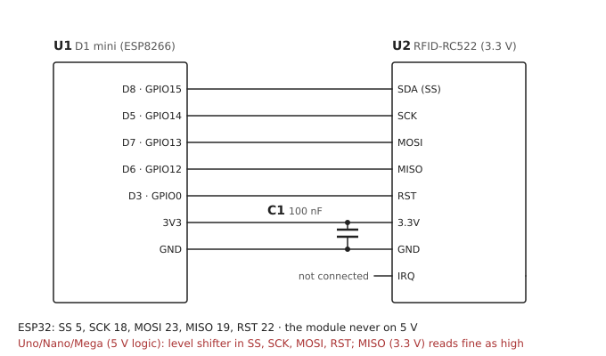

# Rc522

Driver for **NXP MFRC522** 13.56 MHz readers (the blue "RFID-RC522" modules) over SPI.

- Finds ISO 14443A cards and tags: **4-, 7- and 10-byte UIDs**, **several cards in the field**
  at once (full bit-level anticollision), card type from SAK.
- **MIFARE Classic** 1K/4K/Mini: authenticate with key A or B, read and write data blocks
  (block 0 and sector trailers are refused, so a sector can't be bricked by accident).
- **MIFARE Ultralight / NTAG 21x**: read 4 pages, write single pages (pages 0..3 refused).
- CRC_A is computed in software, so each exchange needs fewer SPI transfers.

The protocol is a precompiled C99 core (`rc522.c`, no Arduino, no malloc, no float); the Arduino
adapter `Rc522.cpp` only does SPI and the reset pin, so the core also works with ESP-IDF, the
Pico SDK or Linux spidev.

## Platforms

| Target | Folder in the Arduino zip | Compiler |
|---|---|---|
| ESP8266 (core 3.1.x) | `src/esp8266/` | xtensa-lx106-elf GCC 10.3 (r4d1um/setup) |
| ESP32 (core 2.0.x and 3.x) | `src/esp32/` | xtensa-esp32-elf GCC 8.4 (r4d1um/setup) |
| Uno / Nano / Pro Mini | `src/atmega328p/` | avr-gcc 7.3 (r4d1um/setup) |
| Mega 2560 | `src/atmega2560/` | avr-gcc 7.3 (r4d1um/setup) |
| Linux x86_64 (tests, PC tools) | `.tar.gz` | gcc |

## Wiring



| Module pin | D1 mini | ESP32 | Uno / Nano |
|---|---|---|---|
| SDA (= SS) | D8 | 5 | 10 (level shifter) |
| SCK | D5 | 18 | 13 (level shifter) |
| MOSI | D7 | 23 | 11 (level shifter) |
| MISO | D6 | 19 | 12 |
| IRQ | - | - | - |
| GND | GND | GND | GND |
| RST | D3 | 22 | 9 (level shifter) |
| 3.3V | 3V3 | 3V3 | 3.3V |

The module runs on **3.3 V only**, and the MFRC522's inputs are not 5 V tolerant. On 5 V boards
put a level shifter in SS, SCK, MOSI and RST. Many tutorials skip this and it often seems to
work, but it runs the chip outside its ratings.

## Use it (Arduino)

Download `Rc522-<v>-arduino.zip` from the release `cpp/rc522/v<v>` and install it as a library.

```cpp
#include <Rc522.h>

Rc522 rfid(D8, D3);              // SS, RST (hardware SPI)

void setup() {
  Serial.begin(115200);
  rfid.begin();                  // false: no reader
}

void loop() {
  rc522_uid card;
  if (rfid.find(card)) {
    Serial.println(Rc522::hex(card));      // "04:A3:1F:..."
    Serial.println(Rc522::typeName(card)); // "MIFARE Classic 1K"
    rfid.halt();                           // report each card once per visit
  }
}
```

MIFARE Classic: `rfid.auth(block, key, card)` then `rfid.read(block, buf)` / `rfid.write(block,
buf)`; Ultralight/NTAG: `rfid.read(page, buf)` (4 pages) / `rfid.writePage(page, data4)`.
See `examples/` (`ReadUid`, `ClassicReadWrite`, `NtagText`).

**Card states:** after `find()` the card is ACTIVE. Call `halt()` when done: a halted card is
ignored by `find()` until it leaves the field and comes back, so it's reported once per visit.
Without `halt()`, a card lying on the reader is found on every second `find()` (ISO 14443: an
active card drops to IDLE on the next REQA). `findAny()` also wakes halted cards.

## Use it (plain C)

```c
#include "rc522.h"

static int spi_xfer(void *ctx, uint8_t *buf, uint16_t n) { /* SS low, full duplex n bytes, SS high; 0 = ok */ }
static void wait_us(void *ctx, uint32_t us) { /* sleep */ }

rc522 dev;
rc522_bus bus = { spi_xfer, wait_us, NULL };
rc522_uid uid;
if (rc522_init(&dev, &bus) == RC522_OK && rc522_find(&dev, &uid) == RC522_OK) {
    char hex[32];
    printf("%s %s\n", rc522_uid_hex(&uid, hex, sizeof hex), rc522_type_name(rc522_card_type(uid.sak)));
    rc522_halt(&dev);
}
```

## API (core)

| Function | What it does |
|---|---|
| `rc522_init(dev, bus)` | soft reset, 25 ms card timeout, 100 % ASK, antenna on; `RC522_BUS` if no chip |
| `rc522_antenna(dev, on)`, `rc522_gain(dev, 0..7)` | antenna, receiver gain (7 = 48 dB for more range) |
| `rc522_find(dev, uid)` / `rc522_find_any` | REQA / WUPA, anticollision, select; `RC522_NO_CARD` if none |
| `rc522_halt(dev)` | selected card to HALT |
| `rc522_card_type(sak)`, `rc522_type_name(t)` | Mini, 1K, 4K, Ultralight/NTAG, Plus, ISO 14443-4, ... |
| `rc522_auth(dev, key_b, block, key, uid)` | MIFARE Classic, key A/B; UID3..UID6 for 7-byte UIDs (NXP AN10927) |
| `rc522_read(dev, block, out16)` | 16 bytes: one Classic block or 4 Ultralight pages |
| `rc522_write(dev, block, data16)` | Classic data block (not block 0, not trailers) |
| `rc522_ul_write(dev, page, data4)` | Ultralight/NTAG page 4 and up |
| `rc522_stop_crypto(dev)` | leave the authenticated session |
| `rc522_uid_hex`, `rc522_uid_equal`, `rc522_crc_a`, `rc522_status_name` | helpers |

Every call returns an `rc522_status`: `OK`, `NO_CARD`, `TIMEOUT` (card left mid-exchange),
`COLLISION`, `ERROR` (protocol/parity), `CRC`, `NAK` (card refused: wrong block, not
authenticated, read-only), `AUTH` (wrong key; the card then needs a new `find`), `BUS`, `ARG`.

## Limits

- ISO 14443A only (what the MFRC522 can do): no 125 kHz tags, no ISO 14443B, no FeliCa.
- Phones and bank cards answer as ISO 14443-4; their UID is usually random per tap.
- MIFARE Classic's Crypto1 is long broken: fine for hobby access control, not for anything
  that needs real security. Never use the UID alone as a secret.
- Range is a few cm; `gain(7)` helps a bit.

## Tests

`make test` runs the core against `tests/fake_rc522.h`, a simulated MFRC522 at SPI level
(registers, FIFO, bit framing, IRQs, CollReg, Crypto1 flag) with simulated cards (state
machine, cascade levels, CRC, Classic and Ultralight memory). Includes 500 random rounds of 2-6
cards in the field with near-identical UIDs, which must all be found exactly once. The
multi-card anticollision is checked against this simulation only so far, not against several
real cards at once; single-card operation uses the same register sequences as the common
MFRC522 libraries.

## Build

```sh
make test            # host tests (ASan/UBSan) against the simulated reader and cards
make package         # .a per target, Arduino zip, tarballs, SHA256SUMS in build/pkg/
make firmware-check  # Arduino Uno firmware against the zip (arduino-cli + AVR core)
```
