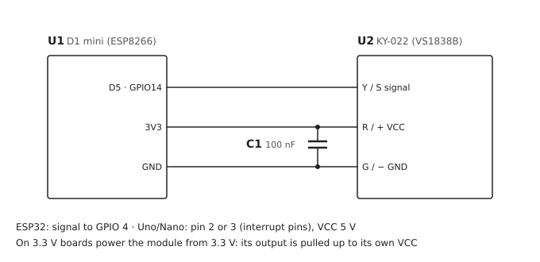

# RemoteRx

Receiver for **infrared remote controls** with a demodulating IR receiver: VS1838B (KY-022
modules), TSOP38238, TSOP4838 and similar 38 kHz parts.

- Decodes **NEC** (incl. 16-bit extended addresses and repeat codes), **Samsung32**,
  **Sony SIRC** 12/15/20 bit, **Philips RC5** and **RC6** mode 0.
- **Unknown remotes** still work: every frame gets a 32-bit hash of its timing pattern (same
  button = same hash), and the raw timings are available for learning.
- **Held buttons**: `repeat` is set for NEC repeat codes, for the same code again within
  200 ms, and from the RC5/RC6 toggle bit (which flips on every new press).
- Capture is a pin-change interrupt that only stores durations. Its code is inlined into the
  adapter's `IRAM_ATTR` handler, so it is safe on ESP8266/ESP32 even while WiFi writes to
  flash. Decoding runs later in `read()`, outside the interrupt.

The decoders are a precompiled C99 core (`irrx*.c`, no Arduino, no malloc, no float);
`irrx_decode()` is a pure function on a list of durations, so it also works with the ESP32 RMT
peripheral or recorded timings.

## Platforms

| Target | Folder in the Arduino zip | Compiler |
|---|---|---|
| ESP8266 (core 3.1.x) | `src/esp8266/` | xtensa-lx106-elf GCC 10.3 (r4d1um/setup) |
| ESP32 (core 2.0.x and 3.x) | `src/esp32/` | xtensa-esp32-elf GCC 8.4 (r4d1um/setup) |
| Uno / Nano / Pro Mini | `src/atmega328p/` | avr-gcc 7.3 (r4d1um/setup) |
| Mega 2560 | `src/atmega2560/` | avr-gcc 7.3 (r4d1um/setup) |
| Linux x86_64 (tests, PC tools) | `.tar.gz` | gcc |

## Wiring



| KY-022 pin | D1 mini | ESP32 | Uno / Nano |
|---|---|---|---|
| Y (S) signal | D5 | 4 | 2 or 3 |
| R (+) VCC | 3V3 | 3V3 | 5V |
| G (−) GND | GND | GND | GND |

Power the module from the same voltage as the board's logic: the VS1838B pulls its output up to
its own VCC. The module's LED (L) flickers when it receives anything, a handy check. Fluorescent
lamps and sunlight can cause short noise frames; they are dropped (fewer than 8 durations).

## Use it (Arduino)

Download `RemoteRx-<v>-arduino.zip` from the release `cpp/remote-rx/v<v>` and install it as a library.

```cpp
#include <RemoteRx.h>

RemoteRx ir(D5);

void setup() {
  Serial.begin(115200);
  ir.begin();                      // false: pin can't interrupt
}

void loop() {
  irrx_result code;
  if (ir.read(code)) {
    RemoteRx::print(Serial, code); // "NEC 0x0 0x45", "Sony 0x1 0x15 repeat", "unknown #9E2C1A07"
    if (code.protocol == IRRX_NEC && code.command == 0x45 && !code.repeat) { /* power button */ }
  }
}
```

`examples/PrintCodes` shows what your remote sends; `examples/ButtonActions` maps buttons to
actions (once per press vs. auto-repeat while held). One `RemoteRx` per sketch.

## Use it (plain C)

```c
#include "irrx.h"

irrx rx;
irrx_init(&rx);
/* pin-change ISR: */  irrx_edge(&rx, micros_now(), pin_level());
/* main loop: */
irrx_result r;
disable_irq(); int ready = irrx_check(&rx, micros_now()); enable_irq();
if (ready && irrx_read(&rx, &r)) printf("%s %04X %04X%s\n", irrx_protocol_name(r.protocol),
                                        r.address, r.command, r.repeat ? " repeat" : "");
```

## Result fields

| Field | Meaning |
|---|---|
| `protocol` | `IRRX_NEC`, `_SAMSUNG`, `_SONY`, `_RC5`, `_RC6`, `_UNKNOWN` |
| `address` | NEC: 8 bit, or 16 bit for extended addresses; Samsung: 16 bit; Sony: 5/8/13 bit; RC5: 5 bit; RC6: 8 bit |
| `command` | NEC/Samsung/RC6: 8 bit; Sony/RC5: 7 bit |
| `bits` | data bits of the frame (Sony: 12, 15 or 20) |
| `repeat` | button held |
| `toggle` | RC5/RC6 toggle bit |
| `hash` | timing hash, set for every frame; the only id of `UNKNOWN` frames |

## Timing notes

- A frame ends after a **5 ms space**. Marks never end a frame (NEC's header mark is 9 ms).
  5 ms is above NEC/Samsung's longest space (4.5 ms) and below the ~6 ms between Sony
  20-bit repeats.
- Receivers stretch marks and shorten spaces by up to ~150 µs. Header checks allow 25 % +
  150 µs, and bit decisions use the midpoint between the two bit lengths. RC6 (only 444 µs per
  half bit) measures the stretch on its 2.7 ms leader and corrects the rest of the frame.
- If `loop()` is slower than the gap to the next frame, that frame is lost, never mixed up
  with the previous one. Call `read()` at least every few ms if you need every Sony repeat.

## Tests

`make test` plays simulated remotes (encoders written from the protocol specs, separately from
the decoders) through a receiver model with 0 / +100 / +180 / −60 µs mark stretch and ±60 µs
jitter, and then through `irrx_edge()` as the interrupt would. That is 300 random codes per
protocol and setting, plus held buttons, toggles, learning of an unknown protocol, noise,
overflow, missed edges and a slow loop. Real remotes have not been tested yet.

## Build

```sh
make test            # host tests (ASan/UBSan) with simulated remotes
make package         # .a per target, Arduino zip, tarballs, SHA256SUMS in build/pkg/
make firmware-check  # Arduino Uno firmware against the zip (arduino-cli + AVR core)
```
